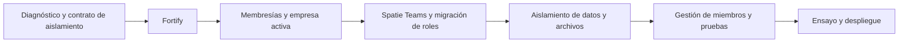

# Roadmap: Fortify y permisos por empresa con Spatie Teams

Fecha: 2026-11-17. Estado: propuesta de implementación; las casillas representan trabajo pendiente.

## Objetivo y arquitectura

Migrar la autenticación generada por Breeze a Fortify y permitir que un usuario pertenezca a varias empresas, con roles diferentes en cada una y datos aislados por empresa.

Supuesto de este plan: varias empresas en una misma base de datos por instancia. El diseño anterior en `superpowers/specs/2026-10-30-multitenant-design.md` plantea una empresa por instancia; esta propuesta amplía ese alcance. Mantener instancias separadas sigue siendo posible. Consolidar bases existentes sería un proyecto adicional, con conciliación de IDs, usuarios y archivos.

Responsabilidades:

| Capa | Responsabilidad |
|---|---|
| Fortify | Login, logout, recuperación y confirmación de contraseña; verificación de correo y 2FA si se habilitan. |
| Sanctum | Autenticación de las peticiones API mediante sesión o token. |
| Spatie Teams | Roles y permisos del usuario en la empresa activa. |
| Membresías | Empresas a las que puede entrar cada usuario. |
| Contexto de empresa + consultas + policies | Aislamiento de los registros, operaciones y archivos. |

Fortify no incluye una interfaz de administración de usuarios. Se conservarán/adaptarán las vistas actuales y se implementará la gestión de miembros y roles. Teams tampoco filtra automáticamente los datos de negocio.

## Punto de partida comprobado

- `composer.json` declara PHP `^8.5`, Laravel `^13.0`, Sanctum `^4.0`, Spatie Permission `^6.18` y Breeze `^2.3` como dependencia de desarrollo. Fortify no está declarado.
- `routes/auth.php` registra los endpoints generados por Breeze. El login regenera la sesión y redirige al dashboard.
- `User` usa `HasRoles`, tiene un `empleado()` de tipo `hasOne` y no tiene una relación de membresías con empresas.
- `Empleado` pertenece a una empresa y tiene varias sedes mediante `empleado_sede`.
- `config/permission.php` tiene `teams => false` y `team_foreign_key => team_id`.
- `ElegirEmpresa` mezcla resolución por sesión y empleado, usa referencias a `empleado->sede` aunque el modelo expone `sedes()`, y termina en `Empresa::first()`.
- Las policies actuales consultan la empresa del empleado. `EmpresaPolicy::delete()` permite la operación por rol `admin` sin comprobar pertenencia.
- `bootstrap/app.php` configura Sanctum, sesiones, middleware de instancia y alias de Spatie; aún no configura contexto de empresa.
- Hay pruebas que esperan que `admin` acceda a cualquier sede. Habrá que distinguir administración de empresa y administración de plataforma.

Son observaciones del código y migraciones; no se ha inspeccionado la base de producción ni ejecutado la suite para elaborar este documento.

## Fase 0 — Inventario y reglas

- [ ] Registrar la línea base de pruebas y rutas; identificar fallos previos.
- [ ] Comprobar compatibilidad real entre PHP, Laravel, Fortify y la versión instalada de Spatie con Composer. No actualizar de versión mayor sin una necesidad comprobada.
- [ ] Inventariar tablas, endpoints web/API, consultas SQL directas, exportaciones, PDF, jobs, comandos, archivos y cachés.
- [ ] Clasificar cada entidad: catálogo global, propiedad de empresa o propiedad derivada de sede/orden. Documentar la ruta de pertenencia.
- [ ] Definir tratamiento de pacientes/personas, exámenes, tarifas y valores de referencia. Propuesta: información clínica y configuración comercial privadas por empresa; compartir solo catálogos de referencia aprobados.
- [ ] Definir unicidad: correo global de usuario; documentos de paciente, consecutivos y claves comerciales según empresa. Revisar índices actuales.
- [ ] Separar `admin` de empresa de un eventual administrador de plataforma. El administrador de empresa nunca obtiene acceso a otra empresa por su rol.
- [ ] Acordar alta por invitación/administración como opción inicial. No permitir elegir empresa o rol libremente desde el registro público.

**Entrega:** matriz entidad → propietario → filtro → permiso, matriz de rutas y reglas de migración de datos. Ninguna entidad operativa queda sin clasificar.

## Fase 1 — Migrar Breeze a Fortify

- [ ] Instalar `laravel/fortify`, ejecutar `php artisan fortify:install` en desarrollo y revisar archivos y migraciones publicados.
- [ ] Registrar/verificar `FortifyServiceProvider` en `bootstrap/providers.php`; configurar guard `web`, broker de contraseñas, email y redirecciones.
- [ ] Conectar las vistas Blade actuales con Fortify. Revisar acciones, campos, mensajes, nombres de rutas y respuestas JSON consumidas por React/API.
- [ ] Migrar los flujos de login, logout, recuperación, confirmación y actualización de contraseña. Revisar especialmente `password.store` y `password.update`: no asumir que todos los nombres o URLs coinciden.
- [ ] Retirar las rutas duplicadas de `routes/auth.php` conforme Fortify asume cada flujo; conservar las rutas propias de perfil que sigan siendo necesarias.
- [ ] Mantener hashes de contraseña, usuarios y permisos existentes. No volver a crear usuarios ni exigir cambio de contraseña por esta migración.
- [ ] Mantener regeneración de sesión, CSRF, limitación de intentos y compatibilidad con Sanctum. No duplicar middleware de cookies/sesiones.
- [ ] Resolver verificación de correo: `User` tiene `MustVerifyEmail` comentado aunque existen rutas con `verified`. Si se activa, planificar usuarios existentes y envío de correos.
- [ ] Dejar 2FA como entrega posterior o implementar vistas, códigos de recuperación y pruebas completas si se incluye.
- [ ] Quitar Breeze de Composer al comprobar que no se necesitan sus generadores. Sus archivos publicados no desaparecen al desinstalar el paquete.

**Aceptación:** usuarios existentes ingresan con sus credenciales; recuperación y logout funcionan; rutas sin duplicados; API conserva el contrato acordado.

## Fase 2 — Membresías y contexto de empresa

- [ ] Crear `empresa_user` con `empresa_id`, `user_id`, estado y timestamps; índice único por pareja y claves foráneas. Los roles permanecen en Spatie.
- [ ] Añadir `User::empresas()` y `Empresa::users()`. La membresía autoriza entrada; un rol aislado no sustituye la membresía.
- [ ] Poblar membresías desde `empleados.empresa_id`. Resolver manualmente usuarios sin empresa y asignaciones ambiguas; generar reporte antes de aplicar.
- [ ] Decidir cómo representar empleo en varias empresas. Si se requieren varios empleados por usuario, migrar `empleado()` a una relación plural y resolver el empleado por empresa; revisar unicidad del documento y referencias existentes. Para administradores sin empleo, la membresía es suficiente.
- [ ] Crear un servicio `EmpresaActual` y un middleware que valide membresía vigente. Guardar IDs de empresa/sede, con un formato único, y cargar modelos desde el servidor.
- [ ] Una membresía: selección automática. Varias: selector. Ninguna: bloquear acceso operativo y mostrar un estado de cuenta sin empresa.
- [ ] Reemplazar el fallback `Empresa::first()`. Sin contexto válido, rechazar la operación.
- [ ] Cambiar empresa mediante POST con CSRF; validar membresía, limpiar sede y estado previo, establecer contexto y redirigir a una pantalla válida.
- [ ] Validar que la sede pertenezca a la empresa activa y que el usuario tenga acceso a ella; conservar restricciones por sede.
- [ ] Definir contexto API: sesión para navegador y empresa vinculada al token o selector validado para integraciones. Nunca confiar únicamente en un header o parámetro.
- [ ] Resolver pestañas con empresas distintas: incluir contexto esperado en las operaciones y rechazar peticiones de una pestaña desactualizada tras cambiar la sesión.

**Aceptación:** manipular empresa/sede en sesión, URL o payload no permite entrar a una empresa ajena; la revocación se comprueba en cada petición.

## Fase 3 — Activar Spatie Teams y migrar autorizaciones

- [ ] Usar `Empresa` como Team, sin crear una entidad empresarial duplicada. Configuración objetivo: `teams => true`, `team_foreign_key => empresa_id`.
- [ ] Generar la migración adicional con `php artisan permission:setup-teams` en desarrollo y revisarla. No modificar una migración histórica ya aplicada ni ejecutar directamente el resultado sobre producción.
- [ ] Diseñar la transformación por etapas: columnas inicialmente compatibles con datos existentes, relleno, verificación y finalmente claves/índices obligatorios. Revisar la interacción con la migración inicial, que lee la configuración, para que funcione también una instalación desde cero.
- [ ] Agregar `empresa_id` a `roles`, `model_has_roles` y `model_has_permissions`. Mantener `permissions` como catálogo de capacidades y `role_has_permissions` como asignación a roles.
- [ ] Crear roles por empresa con guard consistente. Duplicar las definiciones globales necesarias y mapear sus permisos; trasladar cada asignación al rol de su empresa.
- [ ] Para usuarios multiempresa, definir explícitamente qué roles se trasladan a cada membresía. No copiar privilegios a todas las empresas por defecto. Incluir permisos directos y tipos polimórficos en el inventario.
- [ ] Establecer `setPermissionsTeamId($empresaId)` antes de consultar permisos. Al cambiar contexto, descargar relaciones `roles` y `permissions` del usuario.
- [ ] Ordenar middleware: sesión/autenticación → contexto validado → bindings de recursos → autorización. Configurarlo para Laravel 13 en `bootstrap/app.php` y comprobar web y API.
- [ ] Adaptar seeders (`ClienteSeeder`, demo y roles), factories, comandos y administración para establecer contexto explícito antes de asignar roles.
- [ ] Reiniciar contexto al finalizar jobs/operaciones de procesos persistentes, también ante excepciones. Invalidar caché de permisos tras la migración, sin vaciarla en cada petición.

**Aceptación:** la misma persona puede ser `admin` en A y tener acceso limitado en B; asignar o revocar roles en A no modifica B. Un rol global reutilizable no implica acceso global a datos.

## Fase 4 — Separar los datos por empresa

- [ ] Implementar filtros obligatorios reutilizables por empresa, mediante scopes y servicios; aplicar policies como defensa adicional para operaciones sobre registros.
- [ ] Para tablas con `empresa_id`, filtrar por contexto y asignar la empresa desde el servidor. Para otras, seguir relaciones como `orden → sede → empresa`; agregar una columna directa solo con una regla de consistencia y migración justificadas.
- [ ] Revisar listados, búsquedas/autocomplete, conteos, validaciones `exists`/`unique`, bindings, creación, edición, eliminación y operaciones masivas.
- [ ] Validar que todas las referencias pertenezcan a la empresa activa: paciente, sede, orden, convenio, tarifa, procedimiento y demás relaciones. Agregar restricciones de BD donde sea viable.
- [ ] Auditar SQL directo, joins y consultas sin scopes. Toda excepción a un scope necesita contexto y autorización explícitos.
- [ ] Adaptar `ChecksEmpresaAccess`, `EmpresaPolicy` y demás controles a membresía + empresa activa + permiso, eliminando excepciones generales por `admin`.
- [ ] Separar cachés y almacenamiento por empresa cuando contengan información privada. Versionar claves de `localStorage`, limpiar datos al cambiar empresa/logout y evitar respuestas tardías de la empresa anterior.
- [ ] Proteger PDF, resultados y descargas mediante autorización. Un prefijo de carpeta no protege un archivo sensible expuesto por URL pública.
- [ ] Pasar `empresa_id` explícitamente a jobs/comandos; validar contexto, registrar empresa en auditoría y limpiar el contexto en `finally`.

**Aceptación:** conocer el ID o la URL de un recurso de B no permite leerlo, modificarlo, descargarlo ni relacionarlo desde A.

## Fase 5 — Gestión de usuarios y pruebas

- [ ] Crear/adaptar pantallas para invitar miembros, aceptar invitaciones, asignar roles, revocar membresías y seleccionar empresa/sede.
- [ ] Limitar administradores a miembros y roles de su empresa; impedir escalamiento por payload y la eliminación accidental del último administrador activo.
- [ ] Usar invitaciones con token firmado/seguro, expiración y consumo único. Para usuarios existentes, añadir membresía sin recrear identidad.
- [ ] Registrar actor, empresa, destinatario y cambios de roles/membresías en auditoría.
- [ ] Adaptar pruebas existentes de administración global al contrato nuevo.
- [ ] Probar con empresas A/B, administrador A, miembro B, usuario de ambas con roles distintos y usuario sin membresía.
- [ ] Cubrir login/logout/reset, cambio de empresa, rol distinto por empresa, permisos directos, revocación, IDs manipulados, relaciones cruzadas, API, listados, PDF, caché, pestañas y jobs consecutivos A/B en el mismo worker.
- [ ] Probar instalación vacía y actualización de una copia con datos, incluidos roles, asignaciones y registros sin propietario resoluble.

**Aceptación:** pruebas críticas de aislamiento y autenticación aprobadas; no basta con ocultar opciones en la interfaz.

## Fase 6 — Ensayo, despliegue y recuperación

- [ ] Ensayar en staging con copia protegida, medir duración y comparar conteos de membresías, roles y datos antes/después.
- [ ] Hacer backup verificable de BD y archivos y probar restauración. Exportar mapa de asignaciones antiguas/nuevas.
- [ ] Preparar una ventana de mantenimiento: detener escrituras y workers para evitar ejecutar código antiguo con esquema nuevo.
- [ ] Desplegar código/configuración coordinados con migraciones y relleno; verificar integridad antes de reabrir tráfico.
- [ ] Regenerar cachés, limpiar caché de Spatie y reiniciar workers. Verificar flujos reales de dos empresas.
- [ ] Si falla la validación antes de reabrir, restaurar versión, configuración y snapshot coordinadamente. Tras admitir escrituras nuevas, no restaurar un snapshot antiguo sin un plan de conciliación.
- [ ] Actualizar manual, matriz de permisos y documentación de instancias para reflejar la arquitectura implementada.

**Entrega final:** una instancia admite empresas con miembros, roles y datos separados, con operación y recuperación documentadas.

## Orden de entregas revisables

1. Inventario, decisiones y pruebas de línea base.
2. Fortify conservando el comportamiento funcional.
3. Membresías, contexto y selector de empresa.
4. Migraciones Teams, traslado de permisos y seeders.
5. Aislamiento de datos/archivos por grupos de módulos, con pruebas por cada grupo.
6. Gestión de miembros, pruebas integrales y ensayo de despliegue.

Los cambios intermedios de contexto/Teams no se publican como soporte multiempresa hasta completar el aislamiento de todos los módulos. Estimar calendario después del inventario: el tamaño del trabajo depende principalmente de las consultas y datos existentes, más que de instalar Fortify.

## Referencias

- [Fortify para Laravel 13](https://laravel.com/docs/13.x/fortify): instalación, vistas y convivencia con Sanctum.
- [Spatie Permission v6: Teams](https://spatie.be/docs/laravel-permission/v6/basic-usage/teams-permissions): migración adicional, contexto y descarga de relaciones.
- Código local: `composer.json`, `routes/auth.php`, `bootstrap/app.php`, `config/permission.php`, `app/Models/User.php`, `app/Models/Empleado.php`, `app/Services/ElegirEmpresa.php`, policies y migraciones.

Las referencias describen los mecanismos; el diseño de membresías y aislamiento es la propuesta específica para este proyecto. Los comandos de este documento son pasos futuros, no operaciones ejecutadas.
